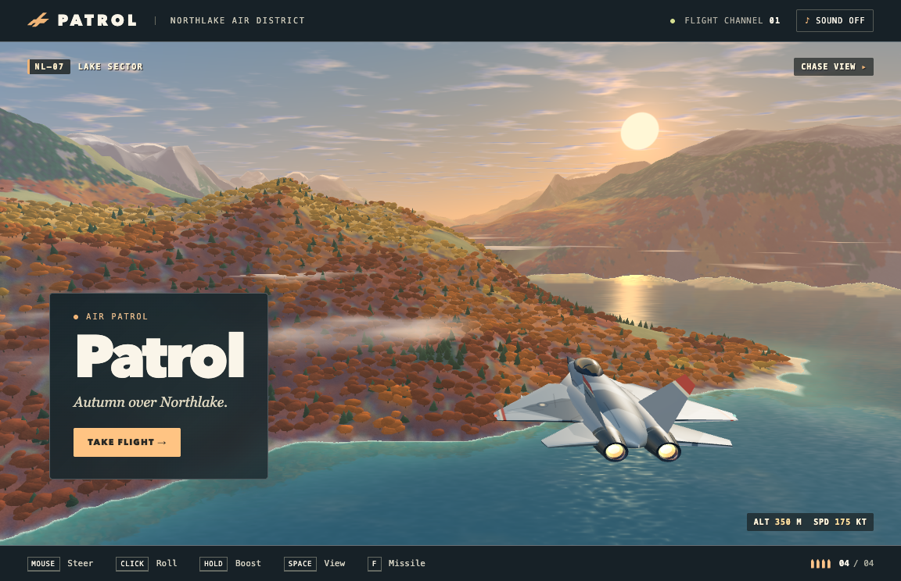

# Aircraft Patrol · 北湖空战与云上奇行

[在线试玩三个版本](https://kinzun.github.io/aircraft-patrol/)，也可以下载 HTML 离线游玩。想驾驶战机掠过秋日湖面、从座舱里锁定敌机，可以选北湖空战；喜欢沿航线穿环、操作机组连续施放大招，可以选云上奇行。每个版本都有独立源码和单文件 HTML。



| 版本 | 玩法与画面 | 在线试玩 | 离线下载 | 源码 |
| --- | --- | --- | --- | --- |
| 云上奇行 · 战机融合 | 鹈鹕、北极熊和悟空共同乘机，沿航线穿环、迎击蜂群和母舰 | [开始飞行](https://kinzun.github.io/aircraft-patrol/versions/fusion/) | [下载 HTML](https://github.com/kinzun/aircraft-patrol/releases/download/v1.0.0/fusion.html) | [versions/fusion](versions/fusion/) |
| 北湖空战 · 像素版 | 自由飞行、翼下导弹和六种空战技能，低分辨率湖区与像素座舱 | [开始飞行](https://kinzun.github.io/aircraft-patrol/versions/pixel/) | [下载 HTML](https://github.com/kinzun/aircraft-patrol/releases/download/v1.0.0/patrol-pixel.html) | [versions/pixel](versions/pixel/) |
| 北湖空战 · 3D 版 | 同一套飞行和空战玩法，使用三维战机、立体秋林、水面反射和矢量仪表 | [开始飞行](https://kinzun.github.io/aircraft-patrol/versions/3d/) | [下载 HTML](https://github.com/kinzun/aircraft-patrol/releases/download/v1.0.0/patrol-3d.html) | [versions/3d](versions/3d/) |

下载后，用支持 WebGL 2 的浏览器打开 HTML。北湖版点击 **TAKE FLIGHT** 起飞，移动鼠标控制战机，按空格切换三种视角；云上奇行按 **Enter** 出击，用 **WASD** 驾驶。更多按键和源码入口见[游玩与开发指南](docs/游玩与开发.md)。

## 从源码运行

克隆仓库后，可以直接打开任一版本目录中的 `index.html`。修改源码后，在对应目录运行回归测试，测试命令会先重新构建页面。开发环境需要 Python 3、Node.js 与 npm，构建使用仓库随附的依赖。

```sh
cd versions/3d
npm test
npm run serve
```

服务启动后打开 [本机预览](http://127.0.0.1:8091/)。

## 飞行设计与提示词

湖区、三种视角与座舱的设计参考了 @vib3coded 的飞行演示。[英文提示词全文](docs/PATROL-PROMPT.md) · [作者的提示词原帖](https://x.com/vib3coded/status/2122472450734559504) · [X 演示对比](https://x.com/vib3coded/status/2124245249786855836)

## 历史与许可

[历史页面](history/archive/)与[早期验证截图和报告](history/review/)记录了骑行原型向战机融合版的演变。各版的架构、历史和参考资料位于对应版本的 `docs/` 目录。

项目原创代码采用 [MIT 许可证](LICENSE)。随仓库分发的 Three.js、技能特效与着色器代码的来源和许可见[第三方说明](THIRD_PARTY_NOTICES.md)。
